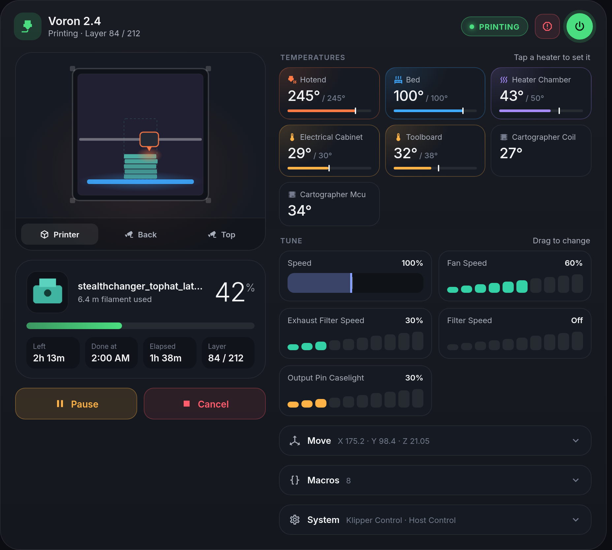
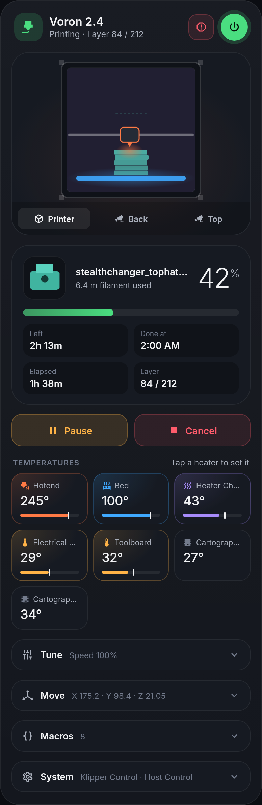
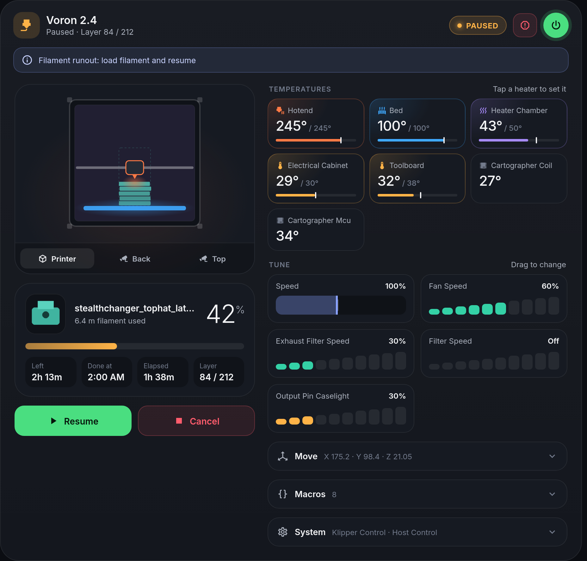
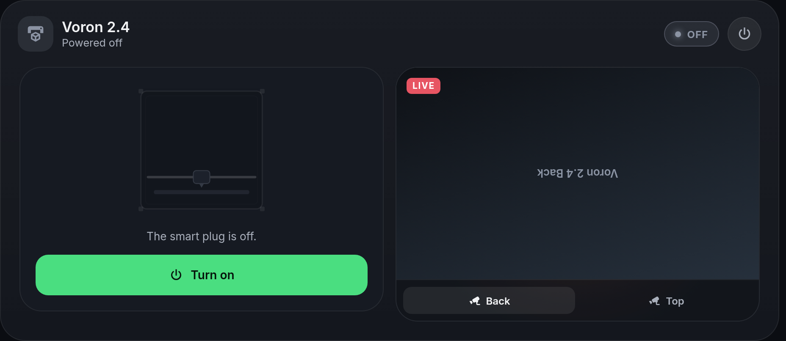
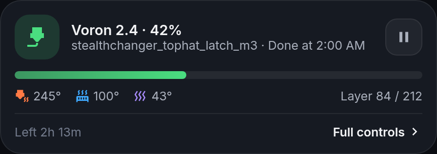
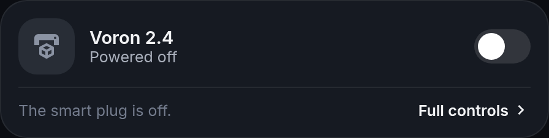
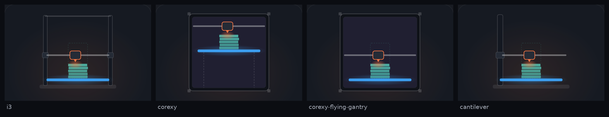

# Lovelace 3D Printer Card for Home Assistant

`lovelace-3d-printer-card` is a custom Lovelace card for monitoring and controlling **Moonraker/Klipper** 3D printers from Home Assistant. Single file, no dependencies, no build step.

Version 3 is a dark, app-style redesign: everything you use during a print is on one page, and the old bottom sheets became folding sections.

- **Live view** — an animated drawing of the printer (i3, CoreXY, CoreXY flying gantry or cantilever) with the part growing layer by layer, heaters glowing while they have a target and the toolhead moving while printing. Tabs switch to each camera (live `<ha-camera-stream>`, with rotation)
- **Progress** — file name with its thumbnail, percent, time left, finish time, elapsed time and layer
- **Pause / Resume / Cancel** — Cancel needs a second tap. Emergency stop sits in the header and also needs two taps
- **Temperatures** — a tile per heater with current and target. Tap a heater to set its target with + / − or presets (PLA / PETG / ABS by default)
- **Tune** — speed and flow sliders, and 10-step drag bars for fans, filters and lights
- **Move** — X/Y/Z position, homing, step sizes and a jog pad (disabled while printing)
- **Macros** and **System** (Klipper, service and host restarts) as folding sections
- **Message banner** for Klipper messages, tinted red on errors
- **Smart plug** — `power_switch` adds a power button. Turning it off mid-print needs a second tap. With the plug off the card shows a Turn on button and the printer's lifetime totals, and the cameras keep working
- **`variant: compact`** — a small glance card with progress and temperatures. "Full controls" opens the full card in a dialog
- **Auto-discovery** — all entities are found from the `base_entity` prefix
- Two columns when the card is wide, one column on a phone. The header never squashes its buttons
- **Device author:** [gil](https://github.com/gilbertorconde) — 2026

---

## Screenshots

| Printing (wide), hotend target open |
|:---:|
|  |

| Phone width | Paused, with a Klipper message |
|:---:|:---:|
|  |  |

| Smart plug off |
|:---:|
|  |

| `variant: compact` printing | `variant: compact` off |
|:---:|:---:|
|  |  |

| Printer types |
|:---:|
|  |

The screenshots use sample data.

---

## Installation

### Option A — HACS (recommended)

1. In Home Assistant, open **HACS → Frontend**.
2. Click the three-dot menu (⋮) in the top-right and choose **Custom repositories**.
3. Paste `https://github.com/gilbertorconde/lovelace-3d-printer-card` and select **Dashboard** as the category.
4. Click **Add**, then search for **Lovelace 3D Printer Card** and install it.
5. Reload your browser / clear the cache.

[](https://my.home-assistant.io/redirect/hacs_repository/?owner=gilbertorconde&repository=lovelace-3d-printer-card&category=dashboard)

### Option B — Manual

1. Download `lovelace-3d-printer-card.js` and the `entities/` folder from the [latest release](https://github.com/gilbertorconde/lovelace-3d-printer-card/releases/latest).
2. Copy the card to `/config/www/lovelace-3d-printer-card/lovelace-3d-printer-card.js` and the `entities/` folder to `/config/www/lovelace-3d-printer-card/entities/`.
3. In **Settings → Dashboards → Resources**, add each file as a resource (type: **JavaScript Module**). Click **Add resource**, enter the URL, then add the next:
   - `/local/lovelace-3d-printer-card/lovelace-3d-printer-card.js` (the card)
   - `/local/lovelace-3d-printer-card/entities/en_generic.js`
   - `/local/lovelace-3d-printer-card/entities/de_generic.js`
   - `/local/lovelace-3d-printer-card/entities/de_bambu_generic.js`
   Add each entity mapping file you use; see the `entities/` folder for available options.

### Add the card to your dashboard

**Minimal config** — the card discovers all entities automatically:

```yaml
type: custom:lovelace-3d-printer-card
name: Voron 2.4
base_entity: voron_24
printer_type: i3
```

**With camera rotation:**

```yaml
type: custom:lovelace-3d-printer-card
name: Voron 2.4
base_entity: voron_24
printer_type: i3
cameras:
  - entity: camera.voron_24_back
    rotate: 180
  - entity: camera.voron_24_top
    rotate: 90
```

**With entity mappings (e.g. German UI):**

```yaml
type: custom:lovelace-3d-printer-card
name: Voron 2.4
base_entity: voron_24
entity_mappings: de_generic
```

**BambuLab with German HA** — use `de_bambu_generic` when the BambuLab integration exposes German entity names:

```yaml
type: custom:lovelace-3d-printer-card
name: Bambu P1S
base_entity: x1c_myprinter
entity_mappings: de_bambu_generic
```

**Check the `entities/` folder** in the repo to see which mapping files are available (e.g. `en_generic.js`, `de_generic.js`, `de_bambu_generic.js`). Use the filename without `.js` as the value.

**Compact glance card** (e.g. inside a room view), opening the full card in a dialog:

```yaml
type: custom:lovelace-3d-printer-card
name: Voron 2.4
base_entity: voron_24
printer_type: corexy-flying-gantry
power_switch: switch.printer_smart_plug
variant: compact
```

**Your own temperature presets:**

```yaml
presets:
  hotend: [{ name: PLA, value: 210 }, { name: ASA, value: 255 }]
  bed: [60, 105]
  number.voron_24_heater_chamber_target: [{ name: ABS, value: 50 }]
```

**With a smart plug power button:**

```yaml
type: custom:lovelace-3d-printer-card
name: Voron 2.4
base_entity: voron_24
power_switch: switch.printer_smart_plug
```

---

## Config Reference

| Key | Type | Required | Description |
|---|---|---|---|
| `base_entity` | string | **Yes** | Entity name prefix, e.g. `voron_24` |
| `name` | string | No | Display name shown in the card header |
| `printer_type` | string | No | `i3` (default), `corexy`, `corexy-flying-gantry`, or `cantilever` |
| `entity_mappings` | string | No | Entity mapping + UI locale. **Check the `entities/` folder** for available options (e.g. `en_generic`, `de_generic`, `de_bambu_generic`). Default: `{hass.locale}_generic` or `en_generic` |
| `cameras` | list | No | Array of `{ entity, rotate }` for rotation overrides only |
| `power_switch` | string | No | Switch entity ID for the printer's smart plug — adds a power button to the header |
| `variant` | string | No | `full` (default) or `compact`: a glance card whose "Full controls" opens the full card in a dialog |
| `presets` | map | No | Target presets per heater, keyed by `hotend`, `bed`, a heater's sensor or target entity ID, or its label. Each item is `{ name, value }` or a number. Defaults: hotend PLA 215 / PETG 245 / ABS 260, bed PLA 60 / PETG 80 / ABS 100 |

---

## How Auto-Discovery Works

On every update the card performs a single pass over `hass.states`, visiting every entity whose ID contains `base_entity`. Each entity is classified by domain and name suffix.

### Hidden entities

Any entity with `attributes.hidden === true` is skipped entirely. This filters out service-management buttons (stop/start/restart klipper, moonraker, crowsnest, etc.) that Moonraker marks hidden in the HA registry.

### Well-known roles — sensor

| Role | Matched suffix(es) |
|---|---|
| Status | `current_print_state` (values: `standby`, `printing`, `paused`, `complete`, `cancelled`, `error`) |
| Printer state | `printer_state` (values: `ready`, `startup`, `shutdown`, `error`) — combined with status for display; `error`/`shutdown`/`startup` take precedence |
| Progress | `progress` |
| Duration | `print_duration` (Moonraker: unit `min`) |
| ETA | `print_time_left` (preferred, unit `h`), `print_eta` (fallback, ISO timestamp) |
| Filename | `filename` |
| Current layer | `current_layer` |
| Total layers | `total_layer` (with or without trailing `s`) |
| Filament used | `filament_used` |
| Message | `current_print_message`, `current_display_message` (combined; banner hidden if both empty) |
| Hotend temp | `extruder_temperature`, `extruder_temp` |
| Bed temp | `bed_temperature`, `bed_temp` |
| Position X/Y/Z | `toolhead_position_x/y/z` |

When multiple entities match the same role (e.g. an alias sensor), the one with a valid (non-unknown/unavailable) state wins. For ETA, `print_time_left` is preferred over `print_eta` (time remaining vs. finish timestamp).

The card converts Moonraker units automatically: `print_duration` (min) and `print_time_left` (h) are converted to seconds for display.

### Well-known roles — number

| Role | Matched suffix |
|---|---|
| Hotend target | `extruder_target` |
| Bed target | `bed_target` |
| Speed factor | `speed_factor` |
| Flow factor | `flow_factor` |

### Well-known roles — button

| Role | Matched suffix |
|---|---|
| Cancel | `cancel_print` |
| Pause | `pause_print` |
| Resume | `resume_print` |
| Emergency stop | `emergency_stop` |
| Home All | `home_all_axes` |
| Home X/Y/Z | `home_x_axis`, `home_y_axis`, `home_z_axis` |
| Firmware restart | `firmware_restart` |
| Host restart | `host_restart` |
| Server restart | `server_restart` |

### Dynamic classification

- **Macros** — `button.*_macro_*` → Macros section
- **Temperature sensors** — `sensor.*` with unit `°C`/`°F`, not matched to a well-known role → paired with a `number.*_target` entity → a settable heater tile. Sensors with no matching target are read-only tiles.
- **Fans/outputs** — `number.*` matching `fan|filter|exhaust|output_pin|light|led`, not already claimed → drag bars in Tune
- **Thumbnail** — `camera.*_thumbnail` → the progress block's thumbnail (shown when state is `printing` or `paused`, only after the URL returns a valid image; falls back to file icon if the feed is empty or fails)
- **Live cameras** — all other `camera.*` entities → live-view tabs

### Labels

Display labels always come from the entity's `friendly_name` attribute, with the device prefix (e.g. `"Voron 2.4 "`) and trailing `" Temperature"` / `" Temp"` stripped. The entity ID is only used as a fallback if `friendly_name` is absent.

---

## Layout

From top to bottom (the second column starts at Temperatures when the card is at least 700 px wide):

- **Header** — name, state and layer, state pill (hidden on narrow cards), emergency stop, power, and a close button in the compact variant's dialog
- **Message banner** — `current_print_message` / `current_display_message`, hidden when empty
- **Live view** — printer drawing and camera tabs
- **Progress** — shown while printing or paused, and after a print completes or is cancelled
- **Pause / Resume / Cancel**
- **Temperatures** — hotend, bed, then other heaters (settable first), then read-only sensors
- **Tune** — speed factor, flow factor, fans and outputs. Folds into a section on narrow cards
- **Move** — position, Home All / X / Y / Z, step size (0.1 / 1 / 10 / 100 mm; Z moves at most 10 mm), jog pad. Disabled while printing (allowed while paused)
- **Macros** — `button.<base>_macro_*`, sorted. Disabled while printing
- **System** — Klipper Control (Restart Klipper, Firmware Restart), Service Control (`button.*_restart_*` and similar), Host Control (Server Restart, Reboot Host, Shutdown Host; the last two need a second tap)

Jog moves are sent via `moonraker.send_gcode` or `klipper.send_gcode` (G91 relative move, then G90). Falls back to `script.<base>_jog` with `{ axis, distance }` variables.

With the plug off (or Moonraker unreachable) the card shows only the header, an off/offline block with **Turn on** and, when the sensors are available, totals from `sensor.<base>_totals_jobs`, `_totals_print_time` and `_totals_filament_used`, plus the cameras.

---

## Printer Types

| Value | Description |
|---|---|
| `i3` | Prusa i3 / Cartesian — two Z rods, X gantry, moving bed |
| `corexy` | CoreXY — gantry fixed at top, bed moves down with object |
| `corexy-flying-gantry` | CoreXY Voron 2.4 — flying gantry moves up with object, fixed bed |
| `cantilever` | Cantilever (Ender-style) — single upright, cantilevered X arm |

---

## Cameras

Cameras are fully auto-discovered from `camera.*<base>*` entities (the thumbnail camera is excluded) and appear as tabs in the live view. Only the selected camera streams, through HA's native `<ha-camera-stream>` element (MJPEG, HLS, WebRTC).

The `cameras:` config array is only needed to specify rotation angles. Unspecified cameras default to `rotate: 0`.

```yaml
cameras:
  - entity: camera.printer_back
    rotate: 180    # flip upside down
  - entity: camera.printer_top
    rotate: 90     # rotate 90° clockwise
```

| Value | Result |
|---|---|
| `0` | No rotation (default) |
| `90` | Rotate 90° clockwise |
| `180` | Flip upside down |
| `270` | Rotate 90° counter-clockwise |

---

## Contributing — Entity Mappings

The card relies on entity mapping files to discover printer entities and translate UI strings. If your printer or language is not supported, the card may show no data. **We welcome contributions.**

### Available options

**Always check the `entities/` folder** in the repo to see which mapping files are available. Currently included:

- `en_generic.js` — Moonraker/Klipper, English (default)
- `de_generic.js` — Moonraker/Klipper, German (includes `verbleibende_zeit` for ETA)
- `de_bambu_generic.js` — BambuLab (ha-bambulab), German — use when HA is set to German and the BambuLab integration uses translated entity names (e.g. `druckfortschritt`, `verbleibende_zeit`, `druckbetttemperatur`)

### How to contribute

1. Add a new JS module in `entities/` following the naming `{language}_{printer}.js`. Examples of files you could add:
   - `en_bambu_p2p.js` — Bambu P2P/P2S, English
   - `de_bambu_p2p.js` — Bambu P2P/P2S, German
   - `de_voron_24.js` — Voron 2.4, German

2. Copy `en_generic.js` as a starting point (use `export default { ... }`), then add or adjust the suffixes for your integration's entity IDs (e.g. BambuLab uses `verbleibende_zeit` for ETA in German).

3. Add UI translations in the `ui` object for buttons, labels, and section headers (e.g. "Pause", "Macros", "Temperatures"). Entity-derived labels use HA `friendly_name` and need no translation.

4. Submit a PR with the new file and a short note in the PR description.

---

## Changelog

**3.0.0**
- New dark, app-style design. The bottom sheets are gone: Tune, Move, Macros and System are folding sections, and the layout is two columns when wide and one on a phone.
- New: camera tabs in the live view instead of a collapsible camera list. Only the selected camera streams, and streams are no longer rebuilt on state updates.
- New: tap a heater to set its target with + / − and presets (`presets` option).
- New: speed and flow drag sliders, and 10-step drag bars for fans and outputs.
- New: `variant: compact` glance card with a Full controls dialog.
- New: off and offline states with a Turn on button and lifetime totals.
- Cancel, host reboot/shutdown, and turning the plug off mid-print now need a second tap.
- Redrawn printer drawings for all four printer types; the toolhead animation no longer redraws the drawing every frame.
- Updates only re-render the parts of the card that changed, so drags and open sections aren't interrupted.
- Icons are inlined, so no icon font is needed.

---

## Requirements

- Home Assistant 2023.4 or newer (a browser with CSS container queries)
- Moonraker integration installed and printer entities exposed to HA
- No additional HACS frontend cards required
